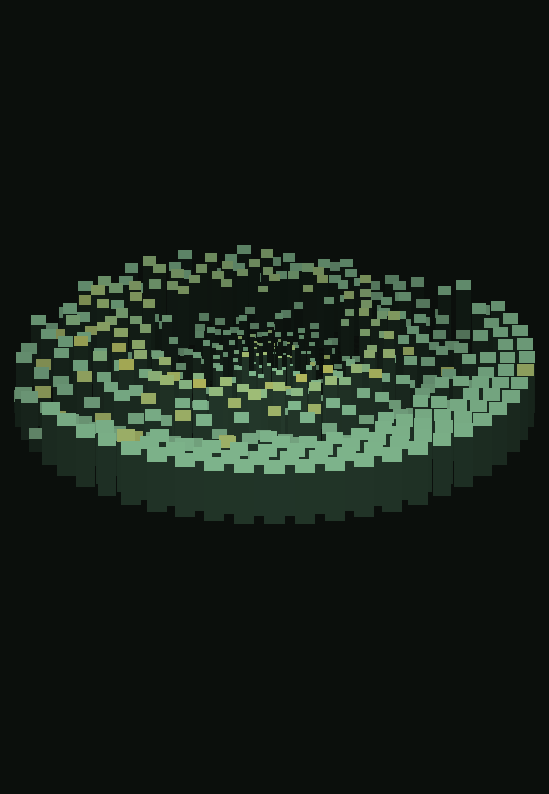
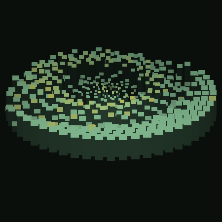

# 控制棒 · REACTOR

纯原生 Android（Kotlin + Canvas）音频驱动悬浮声场。麦克风或设备内部音频 → FFT 频谱 → 桌面/悬浮窗上的立体模块阵列。

> 仓库原本是 AI 生成的第一版，能编译但存在启动崩溃与多处音频生命周期缺陷。本次是一次带审计的续写重构，[docs/AUDIT.md](docs/AUDIT.md) 记录了什么被改、为什么改。

<p>
  
  
</p>

## 功能

- **三种音频源**：演示信号（无需权限）/ 麦克风 / 机内音频捕获（Android 10+）
- **双悬浮层**：桌面透明大窗（仅 Launcher 前台显示）+ 可拖动吸附的小窗
- **快捷面板**：长按小窗呼出，切音源、换背景、开关层、进设置
- **实时 FFT**：1024 点、Hann 窗、48 频段、自适应增益、平滑升降
- **运行诊断**：主界面直接看采样率 / AudioRecord 状态 / read 返回值 / RMS·峰值 / 最近错误
- **可调参数**：灵敏度、帧率(15/20/30)、物理手感、配色主题、模块密度，改完即时生效

## 立即试用

1. 打开 Actions 页面 → 最新成功的 **Build APK** → 下载 `reactor-debug-apk`
2. 手机上安装（需允许「安装未知来源应用」）
3. 打开 App → 授予悬浮窗权限（必须）、使用情况访问（大窗需要）、麦克风（可选）
4. 点「启动悬浮窗」→ 回到桌面看大窗，或看屏幕上的小窗
5. 长按小窗调出快捷面板切换音源

**默认就是演示信号**，不授权任何东西也能看到完整动画，用来确认渲染和悬浮窗是否正常。

## 构建

```bash
./gradlew assembleDebug     # 产物 app/build/outputs/apk/debug/app-debug.apk
```

需要 JDK 17 + Android SDK 34。GitHub Actions 会自动构建并上传 Debug APK。

## 三种音频源怎么用

| 模式 | 需要什么 | 说明 |
|---|---|---|
| 演示信号 | 无 | 严格 8 秒周期循环，循环边界逐位相同，不会跳变 |
| 麦克风 | RECORD_AUDIO + 前台服务 microphone 类型 | Android 12 起必须由可见界面发起，从面板点会自动拉起 App |
| 机内音频 | Android 10+ + 录屏授权 | 只能抓到**允许被捕获**的应用（声明了 allowAudioPlaybackCapture），部分播放器抓不到是系统限制，不是 bug |

机内音频抓不到声音时的判断顺序（诊断面板能区分）：投影是否还有效 → AudioRecord 是否 RECORDING → read 返回值 → RMS 是否真的为 0。不会把「读取失败」当成「没声音」。

## 目录

```
app/src/main/java/com/example/reactor/
├── MainActivity.kt            权限中枢 + 诊断面板，敏感权限一律回到前台再申请
├── audio/
│   ├── AudioEngine.kt         单线程采集/分析，负责三种源切换与自适应增益
│   ├── PcmSource.kt           采集接口，渲染层只依赖频谱快照
│   ├── MicSource.kt           PCM16、读错误处理、安全的 stop 顺序
│   ├── CaptureSource.kt       MediaProjection 机内捕获 + 回调清理
│   ├── SynthSource.kt         严格 8s 循环的演示信号
│   └── SpectrumAnalyzer.kt    1024 点 FFT / 48 频段 / 平滑
├── ui/
│   ├── OverlayService.kt      前台服务 + 双层悬浮窗（重点修复对象）
│   ├── ReactorView.kt         REACTOR 声场绘制
│   ├── QuickPanel.kt          快捷面板
│   ├── BackgroundManager.kt   SAF 背景图
│   └── SettingsActivity.kt    参数设置
└── config/ReactorConfig.kt    参数与持久化
```

## 已验证 / 未验证

**已验证**（开发机）：Gradle 8.2 + AGP 8.2.0 + compileSdk 34 完整编译通过；资源链接、Manifest 合并、APK 打包通过；渲染几何用离线脚本复演验证构图。

**未验证**（没有真机，也没有模拟器）：Android 12 实机上的悬浮窗表现、三种音源的实际采集、ColorOS 后台策略下的存活、真机帧率。

详见 [docs/AUDIT.md](docs/AUDIT.md) 末尾的验收对照表。

## 发行签名

正式版 APK 用固定密钥签名，所以**后续版本可以直接覆盖安装，不需要先卸载**（前提是一直从 Releases 下载）。

`app/build.gradle` 会读这几个环境变量来签 release 包，没有就退回 debug 签名（CI 走的是这条路）：

```bash
export REACTOR_KEYSTORE=/path/to/reactor-release.jks
export REACTOR_KEYSTORE_PASSWORD=...
export REACTOR_KEY_ALIAS=reactor
export REACTOR_KEY_PASSWORD=...
./gradlew assembleRelease
```

当前发行证书指纹（SHA-256）：

```
43:4F:76:2F:F2:9E:7F:6F:D9:A9:84:2F:6E:41:D4:BB:B2:A1:53:D2:06:F9:0D:23:37:ED:03:16:A0:F7:D9:FE
```

> 密钥文件不在仓库里，只在使用者本机保存。CI 产出的是 debug 签名包，适合自己测试；
> 要覆盖升级请用 Releases 里的正式包。

## 更新记录

### v2.2
- 新增「绿色底盘」开关（默认关）：控制声场下方的椭圆柔光
- 新增「画面抖动」开关（默认关）：低频很猛时的整体位移，关闭时彻底静止
- 新增「小窗大小」调节（100–260dp）：实时生效，以小窗中心为锚点缩放，背景图随新尺寸重裁
- 三项都走 `settings.xml` + `OnSharedPreferenceChangeListener` 即时生效链路，无需重启悬浮窗

### v2.1
- 修复启动崩溃、音频采集与停止顺序、快捷面板、设置项不生效

### v2.0
- 修复 Android 12 上 `startForeground` 传入 API 34 才有的 `specialUse` 类型导致的**启动闪退**
- 修复麦克风/机内音频的读取错误处理、停止顺序、PCM16 兼容性
- 重写 REACTOR 声场渲染（2.5D 模块阵列，替代原来的倾斜点阵）
- 新增运行诊断面板与进程内运行日志（无 ADB 也能排查）
- 修复横屏后悬浮窗消失、面板误关、使用情况权限误判等问题

### v1.0
- 首版（AI 生成）

## 许可

MIT
